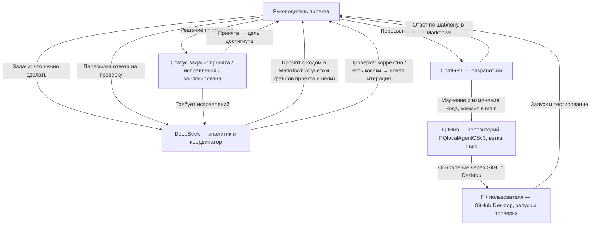

# PROCESS.md — Регламент совместной разработки PQlocalAgentOS v3

Этот документ описывает схему работы над проектом. Он универсален: его достаточно
передать в начало нового чата любому участнику (DeepSeek или ChatGPT), чтобы схема
была понятна без дополнительных пояснений.

## 1. Участники и роли

| Роль | Исполнитель | Задачи |
|------|-------------|--------|
| **Руководитель проекта** | Пользователь | Ставит задачу, пересылает промпты и ответы между ИИ, обновляет код на ПК через GitHub Desktop, запускает, проверяет и выносит вердикт |
| **Аналитик / технический координатор** | DeepSeek | Осмысляет задачу с учётом файлов проекта и конечной цели; формирует ТЗ и промпт с кодом в Markdown для ChatGPT; проверяет ответ ChatGPT на корректность и соответствие цели; ведёт цикл до достижения цели |
| **Разработчик** | ChatGPT | Имеет доступ к репозиторию проекта, изучает актуальный код, вносит изменения, проверяет совместимость, фиксирует изменения в GitHub, отвечает по единому шаблону |
| **Источник кода** | GitHub — репозиторий [PQlocalAgentOSv3](https://github.com/alexpikman/PQlocalAgentOSv3) | Хранит актуальный код, коммиты и историю изменений |
| **Локальная проверка** | ПК пользователя + GitHub Desktop | Обновление кода из репозитория, реальный запуск, пользовательские сценарии, окончательная приёмка |

## 2. Доступ ChatGPT к репозиторию и правила веток

ChatGPT **имеет доступ к репозиторию**
[https://github.com/alexpikman/PQlocalAgentOSv3](https://github.com/alexpikman/PQlocalAgentOSv3) и работает непосредственно с его кодом:

- изучает актуальное состояние файлов в репозитории;
- определяет, что уже реализовано и что нельзя сломать;
- вносит необходимые изменения;
- проверяет код и совместимость с существующими функциями;
- фиксирует изменения в GitHub (коммит).

**Обязательное условие: все правки вносятся только в ветку `main`.**
Создание отдельных веток, пулл-реквестов и слияний не используется — коммиты идут
напрямую в `main`.

Пользователь получает эти изменения на своём ПК через **GitHub Desktop**,
запускает приложение и проверяет реальные сценарии.

## 3. Обязательный порядок работы над каждой задачей

1. **Пользователь** ставит задачу и формулирует, что нужно сделать.
2. **DeepSeek** осмысляет задачу **с учётом файлов проекта и конечной цели**,
   не нарушая схему ролей, и выдаёт **готовый код в формате Markdown** — в виде
   промпта для ChatGPT.
3. **Пользователь** пересылает этот промпт в ChatGPT и ждёт ответа.
4. **Пользователь** пересылает ответ ChatGPT обратно DeepSeek.
5. **DeepSeek** проверяет: правильно ли всё сделано, нет ли ошибок/косяков,
   соответствует ли результат цели и ограничениям проекта.
6. Цикл повторяется (пункты 2–5), **пока не будет достигнута цель**.

Это условие обязательно для каждой задачи и не может быть пропущено или сокращено.

## 4. Требования к ответу ChatGPT

Ответ ChatGPT для DeepSeek **обязательно** должен быть:

1. **В формате Markdown** — с корректной разметкой заголовков, списков, таблиц
   и блоков кода.
2. **Структурированным** — по единому шаблону, чтобы DeepSeek мог быстро
   проверить его и не терял детали.

### Обязательная структура ответа ChatGPT

```markdown
## 1. Что сделано
Краткое описание изменений своими словами — что именно поменялось и зачем.

## 2. Изменённые файлы
| Файл | Что изменено | Причина |
|------|--------------|---------|
| `path/to/file` | ... | ... |

## 3. Код изменений
Полные фрагменты или диффы в блоках кода с указанием языка.
```язык
// код
```

## 4. Что проверено
- [ ] Анализ кода
- [ ] Автотесты (какие именно, результат)
- [ ] Совместимость с существующими функциями
- [ ] Потенциальные регрессии
- [ ] Запуск приложения (если выполнялся)

Честно указать, что проверено, а что нет.

## 5. Как проверить (для пользователя)
Пошаговый сценарий локальной проверки на ПК через GitHub Desktop.

## 6. Риски и ограничения
Что может сломаться, что не покрыто, какие допущения сделаны.

## 7. Коммит
Сообщение коммита, ветка (`main`) и ссылка/хэш, если зафиксировано в GitHub.
```

Если какой-то раздел неприменим — писать «не применимо» с пояснением,
**не пропускать молча**.

ChatGPT **не должен** утверждать, что «всё работает», если проверялся только
исходный код без запуска приложения.

## 5. Цикл разработки и разграничение проверок

```text
Задача (пользователь)
  → осмысление с учётом файлов проекта и цели + промпт с кодом в Markdown (DeepSeek)
  → пересылка промпта (пользователь)
  → ответ ChatGPT по шаблону, в Markdown (пользователь ждёт)
  → пересылка ответа обратно (пользователь)
  → проверка ответа на корректность и соответствие цели (DeepSeek)
  → новая итерация, пока цель не достигнута
  → локальная проверка через GitHub Desktop и приёмка (пользователь)
```

Разграничение проверок:
- **Проверка DeepSeek** — корректность ответа ChatGPT, отсутствие косяков,
  соответствие цели и ограничениям проекта.
- **Проверка ChatGPT** — анализ кода, автотесты, связи компонентов,
  потенциальные регрессии.
- **Проверка пользователя** — обновление на ПК, реальный запуск, интерфейс,
  сценарии, финальное решение.

## 6. Статусы задачи

После проверки пользователем задача получает один из статусов:

- **принята**
- **требует исправлений**
- **заблокирована**

## 7. Ключевой принцип передачи работы

DeepSeek и ChatGPT **не обмениваются историей автоматически**. Передача идёт
через пользователя и явно сформированный контекст:

- задачу;
- ТЗ;
- ограничения проекта;
- текущие изменения;
- результаты проверок.

Пользователь — единственный канал передачи между ИИ.

## 8. Связь с модулем «Проектный менеджер» в PQlocalAgentOS v3

Описанная схема в дальнейшем воплощается в модуле «Проектный менеджер» внутри
PQlocalAgentOS v3 — центральном месте, где хранится и управляется весь цикл,
независимо от того, в каком ИИ обсуждалась задача. Функции модуля:

1. **Задачи** — цель, требования, приоритеты, критерии приёмки
2. **Контекст проекта** — архитектура, ограничения, состояние разработки
3. **Координация** — разбивка на этапы, назначение исполнителей
4. **Передача работы** — формирование промптов для DeepSeek и ChatGPT в нужном
   формате (включая код в Markdown)
5. **GitHub** — отслеживание коммитов и состояния репозитория (ветка `main`)
6. **Проверки** — фиксация выполненных тестов, ошибок, результатов, проверок
   ответов ChatGPT
7. **Приёмка** — замечания и решение о завершении
8. **История** — почему принято то или иное техническое решение, включая
   итерации цикла

## 9. Схема



## 10. Как пользоваться этим документом

Достаточно передать текст документа в начало нового чата DeepSeek или ChatGPT.
После этого:

- **ChatGPT** понимает, что у него есть доступ к репозиторию
  [https://github.com/alexpikman/PQlocalAgentOSv3](https://github.com/alexpikman/PQlocalAgentOSv3), что все правки вносятся только в ветку `main`, как оформлять ответ и что нельзя утверждать
  о работоспособности без проверки.
- **DeepSeek** понимает, что осмысляет задачу с учётом файлов проекта и цели,
  формирует промпт с кодом в Markdown и проверяет ответ ChatGPT.
- **Пользователь** остаётся единственным каналом передачи между ИИ, обновляет
  код на ПК через GitHub Desktop, проверяет и выносит вердикт.
